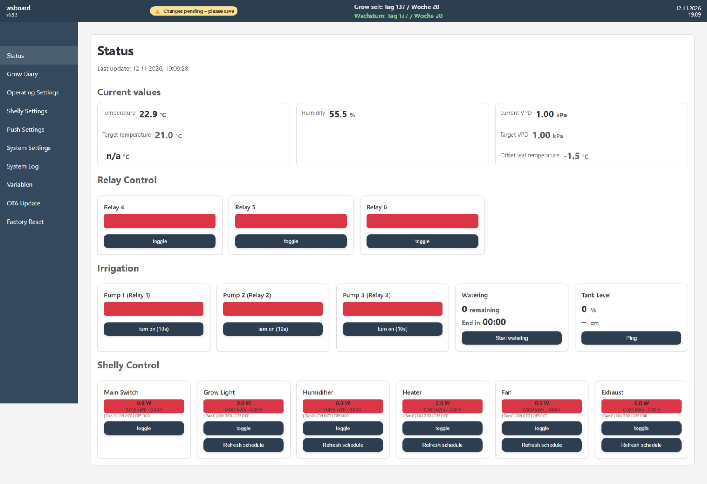

# GrowTent-S3

> ⚡ Smart, adaptive grow tent controller for ESP32-S3 6-channel relay boards with real-time climate stabilization and OTA updates

GrowTent-S3 is the ESP32-S3 version of the GrowTent controller firmware. It is based on the same web UI, automation logic, OTA flow, sensor handling as the classic GrowTent project, but is prepared for the **Waveshare ESP32-S3-Relay-6CH** hardware.

GrowTent reads temperature and humidity, computes VPD (Vapor Pressure Deficit), controls relays and Shelly devices, and provides a German/English web interface for monitoring and configuration. The system is designed for **stable long-term operation** and **minimal manual intervention**.

> **Important:** This repository is the firmware channel for ESP32-S3 relay hardware only. Classic ESP32 boards should use the original `syschelle/GrowTent` repository.

## Current development: v0.5.4

The current migration uses GrowTent **v0.5.3**, commit `55429b128be26f4f722bc67fdff3555f5f967a94`, with the S3-specific six-relay hardware contract. **Hardware validation is pending.**

- [Migration scope, settings compatibility and rollback](MIGRATION.md)
- [Testing and open hardware gates](TESTING.md)
- [Security policy and limitations](SECURITY.md)
- [Latest release notes](RELEASE_NOTES_v0.5.13.md)

Build: `python -m platformio run -e esp32-s3-relay-6ch`.
Dashboard/API: `http://<device-ip>:8080/`; read-only state at `/api/state` and `/state`.
The old synchronous dashboard has been replaced by the upstream AsyncWebServer implementation.
Pump relays 1–3 cannot be used for heater/schedule/general-toggle actions; these are available only on relays 4–6.

---

## Local irrigation planning (v0.5.4)

Firmware-side autonomous scheduling is prepared; backend integration follows separately. The local plan is disabled by default. See [the HMAC plan/event API and safety contract](IRRIGATION_PLAN_API.md), [testing](TESTING.md) and [security](SECURITY.md).

## 🚀 Features

- **ESP32-S3 web interface** for live status and configuration
- **Adaptive sensor smoothing (EMA)**
  - dynamic smoothing based on real-time changes
  - fast response to environmental shifts (e.g. opening tent/window)
  - stable readings in steady conditions
- **Raw vs smoothed sensor values**
  - full transparency for debugging and tuning
- **Stable VPD calculation**
  - based on smoothed values
  - reduces oscillation in control loops
- **6-channel relay board support** for Waveshare ESP32-S3-Relay-6CH
- **Relay scheduling** (minute-based within each hour)
- **Conditional relay logic** (e.g. based on light state)
- **Shelly integration**
  - Main power
  - Grow light
  - Humidifier
  - Heater
  - Fan / exhaust use cases through available relay or Shelly outputs
- **Heater control by temperature**
  - ESP relay or Shelly device
- **Irrigation support**
  - dedicated Pump 1–3 on relays 1–3; individually enabled and sequential
- **Tank level monitoring (HC-SR04)**
  - distance-based water level detection
  - usable for irrigation safety (empty tank protection)
- **Grow Diary**
  - diary storage via LittleFS
  - manual storage repair, no automatic formatting during boot/OTA
- **Built-in log buffer**
- **History and averages**
- **OTA update from GitHub Release binary**
- **Designed for stability**
  - optimized for unattended operation
  - separated OTA release channel for ESP32-S3 hardware

---

## 🌡️ Adaptive Climate Smoothing

The system uses an **adaptive exponential moving average (EMA)** to balance
stability and responsiveness of sensor readings.

### How it works

- Raw sensor values are read from the BME280
- The system calculates the difference between consecutive readings
- Based on this delta, a dynamic smoothing factor (`alpha`) is applied:
  - small changes → strong smoothing
  - large changes → fast reaction

### Example

- Stable environment → smooth values  
- Opening a window → immediate response  

### Benefits

- Reduced sensor noise  
- Stable VPD calculation  
- Faster reaction to real changes  
- Improved control behavior  

---

## Hardware

- Waveshare ESP32-S3-Relay-6CH board
- ESP32-S3 microcontroller
- 6 onboard relay channels
- Adafruit BME280 (I2C at default address `0x76`)
- DS18B20 temperature sensor support
- HC-SR04 sensor support
- Power supply appropriate for the relay board and connected loads
- Shelly devices (Gen1/Gen2/Gen3 depending on endpoint support)

### Default sensor and relay configuration in code

- BME I2C address: `0x76` (`BME_ADDR`)
- I2C SDA: `GPIO8`
- I2C SCL: `GPIO9`
- DS18B20 sensor pin: `GPIO4`
- Relay count: `6` active onboard relays
- Internal compatibility array remains sized for up to 8 relays, but relay 7/8 are disabled on the S3 6CH board

### ESP32-S3 Relay 6CH pin mapping

| Relay | Board channel | GPIO | Firmware role |
|---:|---|---:|---|
| 1 | CH1 | GPIO1 | Pump 1 |
| 2 | CH2 | GPIO2 | Pump 2 |
| 3 | CH3 | GPIO41 | Pump 3 |
| 4 | CH4 | GPIO42 | General relay |
| 5 | CH5 | GPIO45 | General relay |
| 6 | CH6 | GPIO46 | General relay |

The fixed S3 role layout is:

- Pump 1 → Relay 1
- Pump 2 → Relay 2
- Pump 3 → Relay 3
- Pump relay names are fixed in the firmware and cannot be changed in System Settings.
- General relay control, heating selection and minute scheduling → Relays 4–6
- Board selector label in System Settings: `ESP32-S3-Relay-6Ch`

Disabled / not connected in this firmware build:

| Relay | GPIO |
|---:|---:|
| 7 | `-1` |
| 8 | `-1` |

### Wiring notes

- Connect BME280 SDA / SCL to the configured I2C pins (`GPIO8` / `GPIO9` by default).
- Make sure external sensors and the ESP32-S3 board share a common ground where required.
- Respect relay board voltage/current limits and electrical safety requirements.
- Do not OTA-update a classic ESP32 board into this S3 firmware channel.
- First installation on ESP32-S3 hardware should be done via USB with full erase/upload.

---

## Defaults & Constants

- AP SSID: `new growtent`
- AP password: `GT-12$34`
- Measurement interval: `30000 ms` (30 seconds)
- Default NTP server: `de.pool.ntp.org`
- Default timezone is stored as a POSIX-style timezone string and is configurable via the web UI
- Default language: `de` (German)
- Default theme: `light`
- Default units: `metric`
- Default time format: `24h`
- Default VPD targets (per phase): `{ 0.0, 0.8, 1.2, 1.4, 1.0 }`
- Phase names: `["", "Vegetative", "Flowering", "Drying"]`
- OTA release channel: `syschelle/GrowTent-S3`
- Firmware binary: `https://github.com/syschelle/GrowTent-S3/releases/latest/download/firmware.bin`

Preferences keys stored in NVS:

- `ssid` / `password` (WiFi)
- `boxName`
- `lang`
- `theme`
- `unit`
- `timeFmt`
- `ntpSrv`
- Fixed pump roles for Relay 1–3 and configurable names for Relay 4–6
- Grow/run settings

Namespace: `growtent`

---

## Web UI

The web frontend is embedded in program memory and served by the ESP32-S3:

- Main page: `/` (index)
- Stylesheet: `/style.css`
- JavaScript: `/script.js`
- i18n manifest and language JSONs are served from memory
- Factory reset endpoint available via `POST /factory-reset` (form in UI)

UI highlights:

- Gauges for Temperature, Humidity and VPD
- Settings page for language, theme, date/time format, temperature unit, and NTP/timezone configuration
- Relay configuration and relay scheduling
- Shelly configuration
- System log page
- Grow Diary
- Status page
- OTA update page

GrowTent-S3 v0.5.3 running on the Waveshare ESP32-S3-Relay-6CH: dedicated Pump 1–3 on relays 1–3, with general-purpose control relays 4–6.



Languages provided (i18n):

- German (`de`)
- English (`en`)

---

## VPD Calculation

VPD (kPa) is calculated from the measured temperature (°C) and relative humidity (%) using saturation vapor pressure (svp) approximation:

```text
svp = 0.6108 * exp((17.27 * T) / (T + 237.3))
VPD = svp - (RH / 100) * svp
```

Values are updated by a background task and stored in:

- `lastTemperature`
- `lastHumidity`
- `lastVPD`

---

## Software / Libraries

- Arduino framework for ESP32-S3
- Wire (I2C)
- Adafruit_BME280
- Preferences (NVS)
- Adafruit Sensor (sensor abstraction)
- LittleFS
- ArduinoJson
- OneWire
- DallasTemperature

PlatformIO installs the required libraries from `platformio.ini`.

---

## Project Structure

- `src/main.cpp`  
  Web routes, setup, loop, initialization, OTA routes
- `src/function.h`  
  Core logic, control handlers, API builders, settings handlers
- `src/runtime.h`  
  Preferences load and HTML placeholder rendering
- `src/java_script.h`  
  Frontend behavior, status polling, UI updates
- `src/index_html.h`  
  Embedded web page template
- `src/style_css.h`  
  Embedded styles
- `src/task_Check_Sensor.h`  
  Sensor/control task
- `src/task_CheckShellyStatus.h`  
  Shelly poll task
- `src/task_Watering.h`  
  Irrigation task
- `src/ota.cpp`  
  GitHub OTA check and firmware download logic
- `.github/workflows/release-firmware.yml`  
  GitHub Actions release build workflow

All web UI assets are embedded as string literals (`PROGMEM`) and served by the device.

---

## Build & Flash

This repository uses a dedicated PlatformIO environment for the ESP32-S3 relay board:

```ini
[env:esp32-s3-relay-6ch]
```

### First installation on ESP32-S3 hardware

For a new ESP32-S3 board or when moving from a different firmware family, use USB and perform a full erase/upload:

```bash
pio run -e esp32-s3-relay-6ch -t erase
pio run -e esp32-s3-relay-6ch -t upload
```

This is important because OTA updates normally replace only the application firmware, not the bootloader or partition table.

### Normal local build

```bash
pio run -e esp32-s3-relay-6ch
```

### USB upload

```bash
pio run -e esp32-s3-relay-6ch -t upload
```

### Firmware binary location

After a successful build, the firmware binary is generated here:

```text
.pio/build/esp32-s3-relay-6ch/firmware.bin
```

---

## OTA Updates

OTA updates are loaded from this repository's GitHub Release binary:

```text
https://github.com/syschelle/GrowTent-S3/releases/latest/download/firmware.bin
```

The classic ESP32 firmware and the ESP32-S3 firmware intentionally use different repositories and release channels.

Do **not** point an ESP32-S3 device to the classic ESP32 `GrowTent` release channel, and do **not** point a classic ESP32 device to this `GrowTent-S3` release channel.

---

## Configuration & Tuning

- WiFi: You can set the device to Station mode or keep it in AP mode for direct connection.
- NTP and timezone: Set the NTP server and POSIX timezone string via the web UI.
- Relay behavior: Relays are initialized as outputs and default to OFF at startup.
- Relay 1–3 are dedicated pump outputs with fixed names. Relay 4–6 default to `Relay 4`, `Relay 5` and `Relay 6`, while custom names remain configurable.
- Shelly devices can be used alongside the onboard relays.
- LittleFS is not formatted automatically during boot or OTA updates.

---

## API Endpoints

All runtime routes use **TCP/8080**. TCP/80 is reserved for WiFi provisioning. Requests that change runtime state are queued and applied outside the Async callback; follow the returned request ID/status instead of treating a 202 response as proof that hardware switched.

| Method | Endpoint | Purpose |
|---|---|---|
| GET | `/api/state`, `/state` | Flat state JSON, six physical relays |
| GET / POST | `/api/relay/{4..6}/state` | Read state or queue explicit control relay state |
| POST | `/relay/{4..6}/toggle` | Queue control relay toggle |
| POST | `/pump/{1..3}/triggerPump10s` | Queue dedicated enabled pump pulse |
| POST | `/startWatering`, `/toggleWatering`, `/pingTank` | Irrigation / tank actions |
| GET / POST | `/api/settings/relay-name/{4..6}` | Control labels |
| GET / POST | `/api/settings/relay-schedule/{4..6}` | Minute schedule |
| GET / POST | `/api/settings/heating-output`, `/api/settings/irrigation`, `/api/settings/run-profile` | Split operating settings |
| PATCH | `/api/backend/grow-profile` | Optional HMAC-protected backend writes |
| GET / POST | `/api/settings/backend-write` | Backend write configuration |
| POST | `/shelly/{main,light,humidifier,heater,fan,exhaust}/toggle` | Shelly action queue |
| POST | `/api/shelly/reset-energy` | Energy baseline reset |
| GET | `/api/shelly/action-status` | Shelly action result |
| GET | `/api/diary/list`, `/api/diary/csv`, `/api/fs/status` | Diary and filesystem reads |
| POST | `/api/diary/add`, `/api/diary/update`, `/api/diary/delete`, `/api/diary/clear`, `/api/fs/format` | Queued storage actions; destructive actions require their documented confirmation payload |
| GET | `/api/storage/action-status` | Storage result |
| GET | `/api/logbuffer` | Log buffer |
| GET | `/api/ota/check`, `/api/ota/check-status` | Queue update discovery / read result |
| POST / GET | `/api/ota/update`, `/api/ota/update-status` | Queue firmware update / read result |

Relays 1–3 reject generic relay control/scheduling/name changes; relays 7/8 do not exist. The old broad `/savesettings`, `/saverunsettings` and `/saveshellysettings` saves are retired. See `src/main.cpp` for exact schemas, additional split settings paths and action status routes.

## ⚙️ Configuration

- WiFi: AP or Station mode
- NTP + timezone configurable via UI
- Relay logic configurable via UI
- Shelly integration configurable via UI
- Grow/run settings configurable via UI

---

## 🧪 Troubleshooting

- BME280 not found → check wiring, power and I2C address.
- Relays not switching → check the S3 relay GPIO mapping and relay board power.
- No UI → connect to AP:
  - SSID: `new growtent`
  - Password: `GT-12$34`
- LittleFS mount failed → use the manual **Clear diary / repair storage** action. The firmware does not auto-format LittleFS.
- New ESP32-S3 board does not boot correctly → perform USB erase + upload once before using OTA.
- Wrong OTA channel → verify that the firmware URL points to `syschelle/GrowTent-S3`.

---

## Release workflow

Branch/PR builds run `.github/workflows/build.yml` without publishing a release. The tag workflow builds `esp32-s3-relay-6ch`, generates a compact S3 OTA manifest and publishes `firmware.bin` plus `manifest.json`. Keep matching `RELEASE_NOTES_<tag>.md` in the repository. Debug ELF/build information is retained as an Actions artifact. Do not tag this adaptation for production before completing the [hardware gates](TESTING.md).

## Repository split

- `syschelle/GrowTent`  
  Classic ESP32 board firmware
- `syschelle/GrowTent-S3`  
  ESP32-S3 Relay 6CH firmware

This split prevents accidental OTA cross-updates between incompatible ESP32 families.

---

## Contributing

Contributions, bug reports and improvements are welcome. Please open issues or pull requests describing the change and rationale.

---

## License

Apache-2.0

---

### Local irrigation plan editor (v0.5.6)

In Operating Settings, configure the local plan and press **Save plan** separately. The last-watering date can be transferred from known backend history; existing history cannot be cleared or moved back. Disable independent backend scheduling before enabling the ESP plan. Backend HMAC APIs remain available and share the same revisioned persistent plan.

## v0.5.10 backend integration

See IRRIGATION_PLAN_API.md for protocol v2 and signed idempotent manual starts. Command claims persist before starts; unknown expired commands cannot run. Full manual cycles use the backend event stream and require a valid clock and event capacity even with scheduling disabled. Real-device power-failure, pump/phase interlock and push integration validation remain OPEN.

## Humidifier fan coupling (v0.5.14)

See [HUMIDIFIER_FAN.md](HUMIDIFIER_FAN.md) for setup, hourly Auto-Off caching, exclusive relay ownership and limitations.

In v0.5.15, the coupled fan relay’s scheduling controls are disabled and marked in the operating-settings UI. Existing minute values are retained and restored when coupling is removed.

## Shelly settings layout (v0.5.16)

Shared credentials, seven device-role cards and Flood S Gen4 settings now use the operating-settings panel style. Light schedule fields have individual labels. Responsive columns collapse to one on mobile. Existing save, detection and webhook behavior is retained.

## Compact Shelly settings (v0.5.17)

Device function, IP and generation now form aligned rows. The light plan has its own section; credentials and Flood settings are always visible (v0.5.18). All settings still use the same save button.
